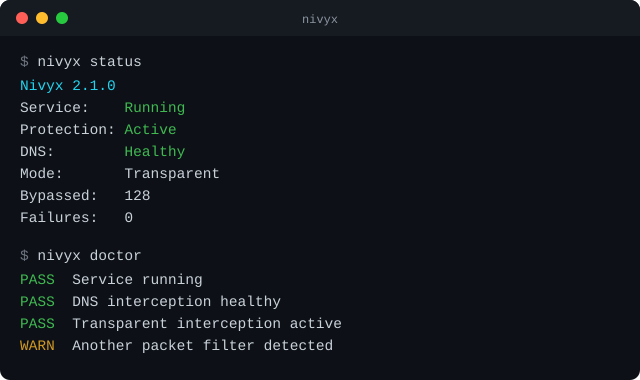

<p align="center">
  
</p>

<h3 align="center">Lightweight system-wide DPI bypass.</h3>
<p align="center">Linux &middot; Windows &middot; macOS</p>

<p align="center">
  <a href="https://github.com/kadireren7/nivyx/actions/workflows/build.yml"></a>
  <a href="https://github.com/kadireren7/nivyx/releases"></a>
  <a href="LICENSE"></a>
  
</p>

Nivyx gets HTTPS traffic past SNI-based DPI (deep packet inspection)
filtering. On Linux, Windows and macOS it runs as a system service:
after one install, blocked sites and apps work in every browser and
application — **automatic and system-wide, with no manual proxy
configuration and no manual DNS configuration**.

It runs entirely on your own machine. It is **not a VPN**, it does not
tunnel through a remote server, and it never decrypts or
man-in-the-middles TLS.

## Platforms

| Platform | What you get | Validation |
|---|---|---|
| Linux (x86_64; arm64 from source) | **Transparent automatic mode** | Real ISP/DPI field-tested (x86_64); arm64 CI-tested |
| Windows 10/11 (x64) | **Transparent automatic mode** | Real ISP/DPI field-tested |
| macOS (Apple silicon, Intel) | **Transparent automatic mode** | Real ISP/DPI field-tested |

`nivyx doctor` prints what your install supports.

## Install

Download the package for your system from
[Releases](https://github.com/kadireren7/nivyx/releases/latest) and
extract it:

| File | For |
|---|---|
| `nivyx-windows-x86_64.zip` | Windows 10/11 x64 |
| `nivyx-macos-arm64.zip` | Apple silicon Macs (M1/M2/M3/M4/...) |
| `nivyx-macos-x86_64.zip` | Intel Macs |
| `nivyx-linux-x86_64.tar.gz` | Linux x86_64 (Debian 12, Ubuntu 22.04 and newer) |

Every package contains the same few things:

| | Windows | macOS | Linux |
|---|---|---|---|
| Install | `Install Nivyx.cmd` | `Install Nivyx.command` | `sudo ./install.sh` |
| Update | `Update Nivyx.cmd` | `Update Nivyx.command` | `sudo ./update.sh` |
| Uninstall | `Uninstall Nivyx.cmd` | `Uninstall Nivyx.command` | `sudo ./uninstall.sh` |
| Command | `nivyx.cmd` | `nivyx` | `nivyx` |

plus a short `QUICKSTART.txt` and a `files` folder the scripts use.
Windows asks for administrator rights, macOS for your password.

The installer checks DNS and HTTPS through the service before it
finishes and starts it at boot: nothing to configure afterwards. Before
installing, stop other DPI tools or VPN packet filters (`nivyx doctor`
checks for the ones it can detect). `SHA256SUMS` in the release lists
the checksum of every package.

**Upgrading from v2.4.0 or earlier:** run the new package's installer
once (its `nivyx update` cannot read the new package layout). Settings
and learned state are kept; later updates work with `nivyx update`
again.

**Other Linux systems** (Fedora, Arch, arm64, ...) install from source:

```bash
git clone https://github.com/kadireren7/nivyx.git
cd nivyx
sudo ./scripts/install.sh
```

Guides: [Linux](docs/linux.md) · [Windows](docs/windows.md) · [macOS](docs/macos.md)

**Testing status:** releases are tested automatically on GitHub-hosted
Linux, macOS and Windows machines (install, upgrade, update, rollback,
repair, uninstall). They have **not yet been validated on physical
consumer devices** (real PCs and Macs with antivirus, Raspberry Pi, real
DPI networks); see docs/RELEASE-CHECKLIST.md.

## Usage

One command, the same on every platform (`start`/`stop`/`restart`/
`reload`/`repair`/`update` need root/Administrator):

```
$ nivyx status
Nivyx 2.4.1
Service: Running
Protection: Active
DNS: Healthy
Mode: Transparent
Bypassed: 128
Failures: 0
```

<p align="center">
  
</p>

```
nivyx status [--verbose]    # short summary / full detail
nivyx doctor                # read-only health checks (PASS/WARN/FAIL)
nivyx diagnose discord.com  # DNS, HTTPS and the stored decision for one site
nivyx stats                 # local counters (no browsing history)
nivyx logs 50
nivyx config show|path|check|set|unset   # manual rules, safely
nivyx repair                # fix Nivyx-owned state (service, stale rules, files)
nivyx update [--check]      # verified self-update with automatic rollback
nivyx support-bundle        # local diagnostics archive, redacted, no telemetry
nivyx restart | stop        # (root/Administrator)
nivyx help [command]
```

Full reference, including exactly what `doctor` checks, what `repair`
touches and what `support-bundle` redacts: [docs/cli.md](docs/cli.md).

Output is colored on a terminal (green/yellow/red for
healthy/warning/failed) and plain when piped, redirected, or when
[`NO_COLOR`](https://no-color.org) is set.

Optional manual rules go in `strategy.conf` (`nivyx config path`,
e.g. `nivyx config set example.com tlsrec`); none are needed —
known-blocked services get the bypass automatically, other sites are
tried directly first and only bypassed if they need it. Manual rules
always win over automatic learning and are never changed unless you
ask.

## Limitations

- **Not a VPN.** Traffic leaves from your own connection with your own
  IP address. Sites blocked by IP address, or services that block your
  region, are not reachable this way.
- **HTTPS and DNS only.** Other UDP traffic — voice and video calls,
  game traffic — is not touched (e.g. Discord text and media work,
  voice may not).
- **Network-dependent.** DPI systems differ between ISPs and change
  over time; this bypasses DPI that inspects the TLS server name
  without reassembling TLS records, not every censorship system.
- **One interceptor at a time.** Don't run another transparent DPI
  tool (dpi-bypass, GoodbyeDPI, zapret, …) alongside it — `nivyx
  doctor` and the service itself warn if they detect one.
- **Field-tested, not exhaustively validated.** All three platforms
  are end-to-end tested in CI on real runners, and field-tested
  against real ISP-level DPI (Windows and macOS each on one physical
  machine); not yet validated across a wide range of consumer hardware
  and networks. Platform-specific details and limitations:
  [docs/windows.md](docs/windows.md), [docs/macos.md](docs/macos.md).

## Uninstall

A plain uninstall keeps your settings and learned state on every
platform (a reinstall picks them up); `--purge` (Windows: `-Purge`)
removes them too.

Windows: double-click `Uninstall Nivyx.cmd`. macOS: double-click
`Uninstall Nivyx.command`. Linux: `sudo ./uninstall.sh` in the package
(source installs: `sudo ./scripts/uninstall.sh`).

## Documentation

- [docs/cli.md](docs/cli.md) — full `nivyx` command reference.
- [docs/linux.md](docs/linux.md), [docs/windows.md](docs/windows.md),
  [docs/macos.md](docs/macos.md) — platform-specific install, commands,
  files, troubleshooting, and how each one touches the system
  (nftables / WinDivert / PF).
- [docs/transparent-mode.md](docs/transparent-mode.md) — how the
  engine works (all platforms): DNS, the decision ladder, fail-open,
  operation.
- [docs/development.md](docs/development.md) — building, tests,
  sanitizers, CI.
- [docs/performance.md](docs/performance.md) — package size breakdown
  and measured resource use, per platform;
  [docs/performance-v2.2.md](docs/performance-v2.2.md) — v2.1 vs v2.2.
- [docs/security.md](docs/security.md) — release trust, dependencies,
  provenance, privacy and logging.
- [docs/packet-mode.md](docs/packet-mode.md),
  [docs/architecture.md](docs/architecture.md),
  [docs/discovery.md](docs/discovery.md),
  [docs/network-profiles.md](docs/network-profiles.md) — the optional
  packet-mode engine (Linux, advanced).

## License

MIT — see [LICENSE](LICENSE).
